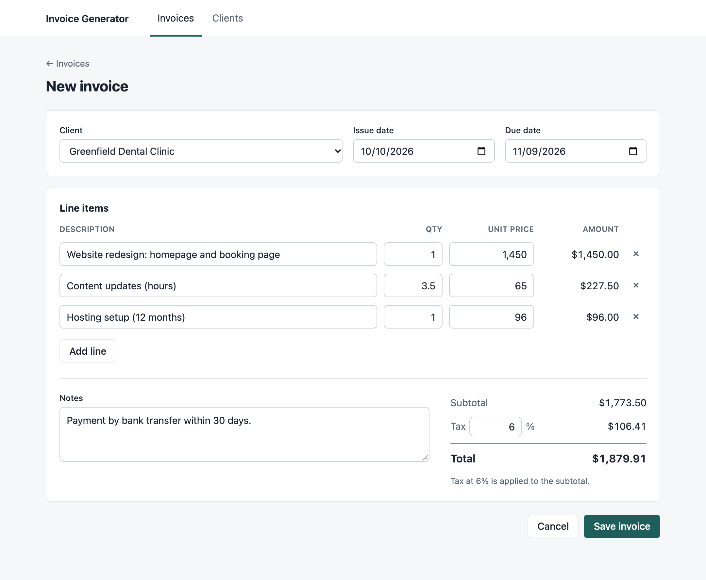
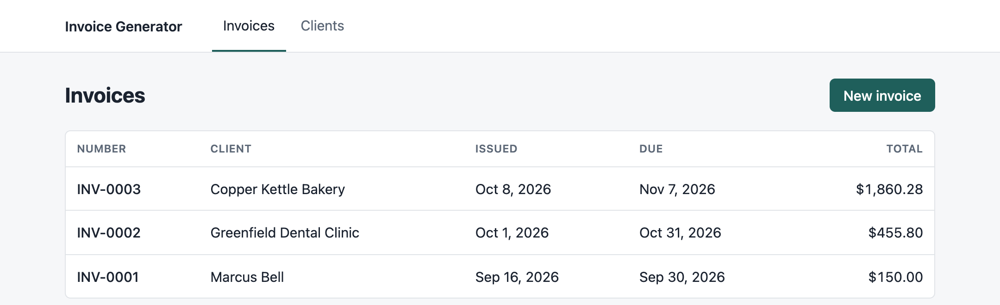
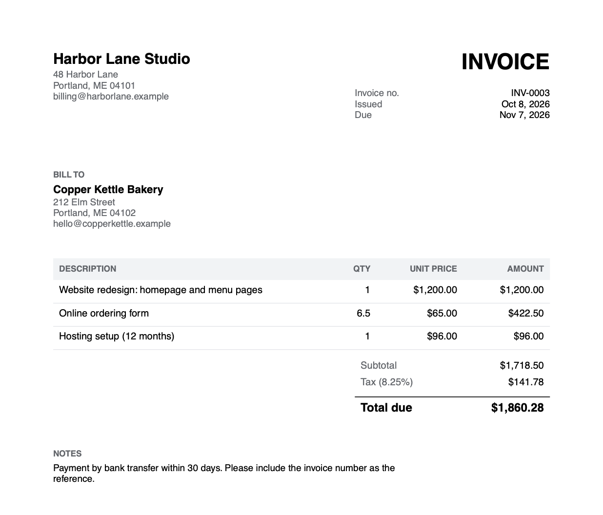

# Invoice Generator

A small web app for freelancers and small businesses: save your clients, build an invoice line by line with totals and tax worked out for you, and download it as a PDF.



## What it does

- **Clients.** Save each client's name, email and address once, then pick them from a list.
- **Invoices.** Add as many lines as you need. Quantities can be fractional, which suits hourly work (for example, 3.5 hours × $65). Each line amount, the subtotal, the tax and the total update as you type.
- **Tax.** Set any rate, such as 8.25%. Tax is charged once on the subtotal and rounded to the nearest cent.
- **PDF export.** Every invoice downloads as a clean, printable US Letter PDF with an invoice number, issue and due dates, and your notes.

| Invoice list | The downloaded PDF |
| --- | --- |
|  |  |

## Run it on your computer

You need [Node.js](https://nodejs.org) 22 or newer.

```bash
npm install
npm run dev
```

Then open http://localhost:5173. The app starts with three example clients and invoices, so you can try it straight away.

## Deploy a free live demo on Render

The repo includes a [`render.yaml`](render.yaml) blueprint, so deploying takes a few clicks:

1. Push this repo to your GitHub account.
2. In the [Render dashboard](https://dashboard.render.com), choose **New → Blueprint** and select the repo.
3. Accept the defaults. Render builds the app and gives you a URL like `https://invoice-generator-xxxx.onrender.com`.

Two things to know about Render's free plan:

- The service goes to sleep after 15 minutes without visitors, so the first page load after that takes up to a minute.
- The database is reset to the example data whenever the service restarts or redeploys. That's fine for a demo, but for real use you would attach a persistent disk ($) and point `DATABASE_PATH` at it.

Why Render and not Vercel? Vercel runs back ends as short-lived serverless functions, which can't keep a SQLite file between requests. Render runs a normal, always-on Node server, so the app deploys as-is.

## Settings

All settings are optional environment variables:

| Variable | Default | What it does |
| --- | --- | --- |
| `BUSINESS_NAME` | Harbor Lane Studio | Your name or company name, shown at the top of every invoice |
| `BUSINESS_EMAIL` | billing@harborlane.example | Shown under your name |
| `BUSINESS_ADDRESS` | 48 Harbor Lane… | Use `\n` for line breaks |
| `DATABASE_PATH` | `data/invoices.db` | Where the SQLite file is stored |
| `SEED_DEMO_DATA` | `true` | Add the example clients and invoices when the database is empty |
| `PORT` | `3001` | Port for the API server |

## Tests

```bash
npm test
```

The tests cover the money logic: line amounts with fractional quantities, rounding half a cent, tax on the subtotal, a 0% rate, empty invoices, and very large amounts. They also test parsing of typed values like `$1,250.50`, and every API endpoint, including validation errors and the PDF download. `npm run typecheck` checks the TypeScript.

### How the money is calculated

All amounts are stored as whole numbers: cents for money, hundredths for quantities, and basis points for tax rates (8.25% is stored as 825). That avoids floating-point surprises such as `0.1 + 0.2 = 0.30000000000000004`. The calculation lives in a single file, [`src/shared/totals.ts`](src/shared/totals.ts), which both the browser (for the live preview) and the server (for saved invoices and PDFs) use, so the two can never disagree.

## Project layout

```text
src/shared/    money parsing, totals and tax, shared types (used by both sides)
src/server/    Express API, SQLite storage, PDF rendering, demo data
src/client/    React pages: invoice list, new invoice form, invoice view, clients
```

Built with React, TypeScript, Vite, Express, SQLite (better-sqlite3), pdfkit and Zod.

## License

MIT. See [LICENSE](LICENSE).
